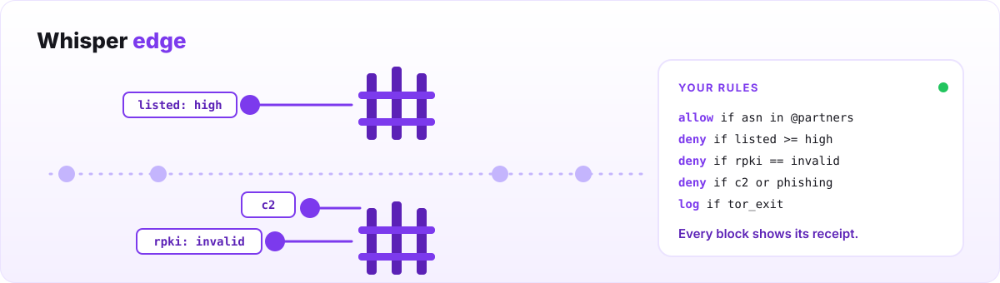

<p align="center">
  
</p>

<p align="center">
  <b>Firewall rules for your web server that know who owns, routes and has flagged every address on the internet.</b><br>
  For nginx, Apache, OpenLiteSpeed, BIND and Unbound. Free, MIT, and nothing leaves your server.
</p>

<p align="center">
  <a href="LICENSE"></a>
  <a href="https://whisper.online/edge/"></a>
</p>

## Say what you mean

Most firewalls only know an IP address. Whisper edge knows what is behind it, so your rules can say what you actually mean:

```nginx
whisper_edge_policy "allow if asn in @partners";      # your partners always get in
whisper_edge_policy "deny  if listed >= high";        # on a cited public blocklist
whisper_edge_policy "deny  if rpki == invalid";       # announced by a network that does not hold it
whisper_edge_policy "deny  if c2 or phishing";        # known attack infrastructure
whisper_edge_policy "log   if tor_exit or vpn";       # see it, do not block it

location /login {
    whisper_edge_policy "deny if country in @blocked and not asn in @partners";
}
```

The first rule that matches decides. Rules work per site, per path or per directory, and they are checked when your server loads its config, with the line, the column and a fix if something is wrong. Twenty-five facts about every address: who owns it, where it is routed from, whether that route is valid, its reputation, whether it is a Tor exit, a proxy or attack infrastructure, and your own lists. [The rule language](POLICY.md)

## Every block comes with a receipt

Ask about any address, on your own machine. Real output from today's data:

```
$ whisper-edge-lookup 2.26.75.1 | grep '^decision'
decision deny enforce=yes step=sugar rule=1 text="deny if listed >= high"
```

Every block your server makes writes the rule and the evidence behind it to your own error log. Nothing is a black box, and if we ever get an address wrong you can see exactly why.

## Install

```sh
git clone https://github.com/whisper-sec/whisper-edge-reputation && cd whisper-edge-reputation
./nginx/build.sh && sudo ./nginx/build.sh --install     # or ./apache/build.sh, ./litespeed/build.sh
sudo ./install/install.sh
```

The installer finds your servers, checks the signed data, adds a sensible default policy, runs your server's own config test and reloads only if it passes. It ends by printing the lines that undo everything. Add `--dry-run` to see what it would change first. [Full guide](REFERENCE.md#start-here-one-command)

## Safe by design

- **It never breaks the internet around you.** DNS root and TLD servers, public resolvers, certificate authorities and ACME, NTP, RPKI and registry infrastructure are never blocked, whatever any rule says. [The list](hold-harmless.txt)
- **It fails open.** If the data is missing or out of date, your site keeps serving.
- **It only blocks what it can back up.** Each build publishes what it refused to block and why: [`snapshot.json`](https://whisper.online/edge/snapshot.json).
- **It costs nothing per request.** Decisions are a lookup in local memory. Your server talks to nobody while it serves.

## How it compares

| | Whisper edge | IP list in your firewall | fail2ban | CrowdSec | Cloudflare and other proxies |
|---|---|---|---|---|---|
| Rules about owner, routing and reputation | ✅ | no | no | partly | ✅ |
| Works before the first attack | ✅ | ✅ | reacts to your logs | ✅ | ✅ |
| Says why it blocked | ✅ the rule and the evidence | no | the matching log lines | the scenario or list name | the rule that fired |
| Per site and per path rules | ✅ | no | per jail | partly | ✅ |
| Your traffic stays on your server | ✅ | ✅ | ✅ | ✅ | no, it flows through them |
| Sends nothing about your traffic out | ✅ | ✅ | ✅ | shares attack signals by default | no |
| Also covers SSH and other services | no | ✅ | ✅ | ✅ | with Tunnel or Spectrum |

It works well alongside fail2ban or CrowdSec. It is not a DDoS shield: for floods, use an upstream provider.

## Where it runs

**nginx**, **Apache httpd** and **OpenLiteSpeed** as a native module. For a **DNS resolver** (BIND, Unbound), the same data ships as a signed policy zone that keeps the people behind your resolver away from listed networks: see [`rpz/`](rpz/README.md).

## Questions

**Is it really free?** Yes. Blocking listed networks needs no key and no account. A free key adds routing, threat and anonymiser data, and your own allow and deny lists on every server you run: [whisper.security](https://whisper.security).

**Does it phone home?** No. It downloads public, signed files every hour. Every decision is made on your server.

**I blocked someone by mistake.** Run `whisper-edge-lookup <address>` to see why, then tell us at `abuse@whisper.security`.

**How do I remove it?** Paste the undo lines the installer printed.

## Learn more

[The rule language](POLICY.md) · [Full guide](REFERENCE.md) · [The data](DATA.md) · [How it works](ARCHITECTURE.md) · [Security](SECURITY.md)

---

<sub>MIT licensed and free forever. Built by <a href="https://whisper.security">Whisper Security</a>, who map how the internet's networks, names and certificates connect, in one graph of about 47 billion objects.</sub>
